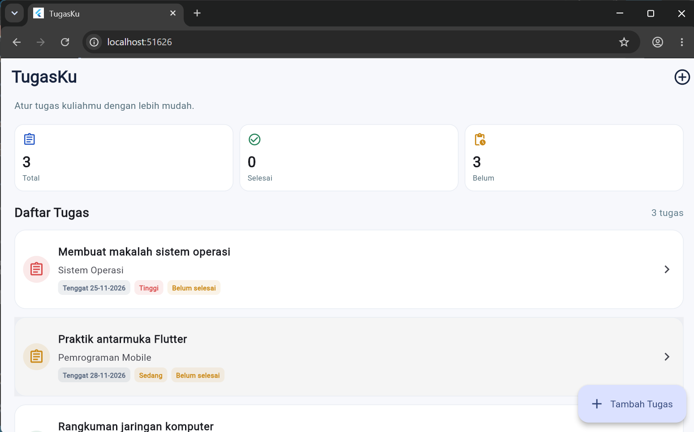
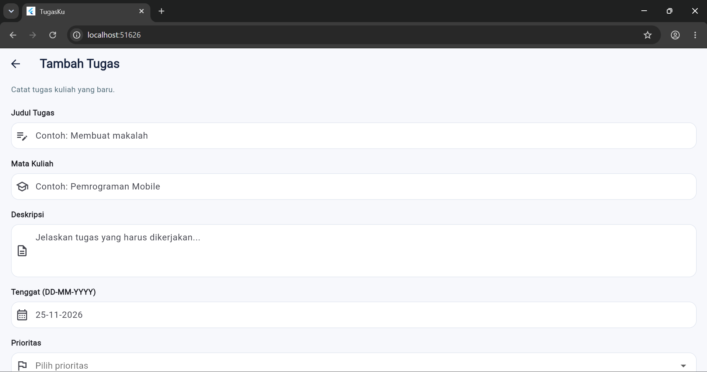
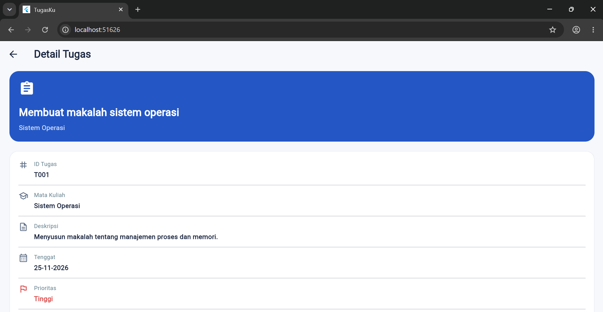
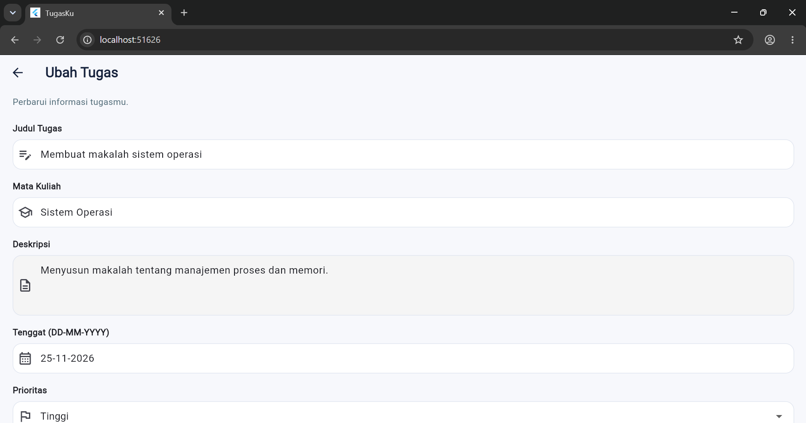

# 📚 TugasKu – Aplikasi Pencatat Tugas dan Tenggat Kuliah

TugasKu merupakan aplikasi mobile berbasis Flutter dan bahasa pemrograman Dart yang dirancang untuk membantu mahasiswa mencatat, mengelola, dan memantau tugas perkuliahan agar lebih terorganisir.

Aplikasi ini menerapkan konsep CRUD (*Create, Read, Update, Delete*) dengan tampilan sederhana, modern, dan mudah digunakan.

## 👩‍🎓 Identitas Pengembang

| Keterangan | Identitas |
|---|---|
| Nama | Riza Fitria |
| NIM | C2483207031 |
| Program Studi | Pendidikan Teknologi Informasi |
| Fakultas | Keguruan dan Ilmu Pendidikan |
| Universitas | Universitas Muhammadiyah Tasikmalaya |
| Mata Kuliah | Pemrograman Mobile |
| Dosen Pengampu | Alamsyah Firdaus, M.Kom. |
| Tahun Akademik | 2026/2027 Ganjil |

## 🛠️ Teknologi yang Digunakan

- **Flutter** – Framework pengembangan aplikasi mobile.
- **Dart** – Bahasa pemrograman.
- **Visual Studio Code** – Code editor.
- **Android Emulator** – Untuk menjalankan dan menguji aplikasi.

## ✨ Fitur Aplikasi

1. **Dashboard Tugas** – Menampilkan ringkasan jumlah seluruh tugas, tugas selesai, dan tugas yang belum selesai.
2. **Menambahkan Tugas (Create)** – Menambahkan tugas baru berdasarkan judul, mata kuliah, deskripsi, tenggat waktu, dan prioritas.
3. **Melihat Tugas (Read)** – Menampilkan daftar dan detail informasi tugas.
4. **Mengubah Tugas (Update)** – Mengedit informasi tugas yang sudah dibuat.
5. **Menghapus Tugas (Delete)** – Menghapus tugas yang tidak diperlukan.
6. **Validasi Form** – Memastikan data yang dimasukkan sesuai dengan ketentuan.
7. **Prioritas Tugas** – Mengatur prioritas tugas menjadi Rendah, Sedang, atau Tinggi.
8. **Status Tugas** – Mengubah status penyelesaian tugas.

## 📸 Screenshot Aplikasi

Berikut dokumentasi tampilan aplikasi TugasKu:

### 1. Halaman Utama

### 2. Halaman Tambah Tugas

### 3. Halaman Detail Tugas

### 4. Halaman Edit Tugas

> Catatan: Simpan screenshot aplikasi ke dalam folder `screenshots` dengan nama file sesuai gambar di atas. Ganti nama atau sesuaikan jika tampilan aplikasimu berbeda.

## 💻 Cara Instalasi dan Menjalankan Aplikasi

### 1. Persyar
